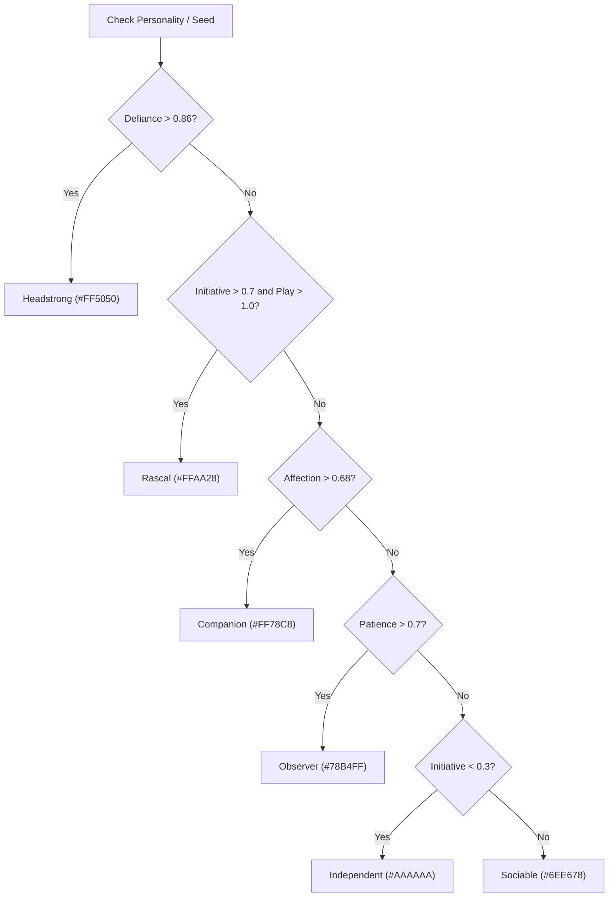

# Pet Trait Vector Reference Sheet

A complete reference for pet and animal temperament vectors, ESP representations from [`luascripts/pet_esp.lua`](file:///Users/jsph/cowhub/luascripts/pet_esp.lua), and underlying behavioral mechanics in Cow Game (`Place_82507849398215_Folder_Shared_1794016208.txt`).

---

## 1. ESP Billboard & Vector Layout

In [`luascripts/pet_esp.lua`](file:///Users/jsph/cowhub/luascripts/pet_esp.lua), pet models carry no native attributes. The ESP discovers running controller tables via `getgc()` (`DogController` and `BarnCatController`) to map each `Model` to its internal `Record`. Any trait absent from `Record.Personality` is deterministically computed from `Record.Seed` via the game's PRNG function `sample(seed, salt)`.

### Billboard Format
```text
<Icon> <Name/Species> (<Variant>) [young]
<Disposition> · <Descriptor>
Ini <v>  Aff <v>  Pat <v>  Def <v>
Dom <v>  Tim <v>  Ldr <v>  Neu <v>
Trb <v>  Wan <v>  Thr <v>  Hi <v>
Play <v>  Curi <v>  Bold <v>  Tempo <v>
[<dist> studs]
```

### Example Visual Output
```text
🐕 Daisy (Golden)
Rascal · playful
Ini 0.78  Aff 0.45  Pat 0.32  Def 0.15
Dom 0.65  Tim 0.22  Ldr 0.81  Neu 0.11
Trb 0.90  Wan 0.54  Thr 0.31  Hi 0.10
Play 1.25  Curi 0.85  Bold 1.10  Tempo 1.12
[42 studs]
```

---

## 2. Trait Vector Breakdown

The trait vector is partitioned into 3 fixed ESP display rows and a 4th dynamic extras row:

| ESP Tag | Trait Name | PRNG Salt | Range | In-Game Behavioral Meaning |
|:---|:---|:---:|:---:|:---|
| **Row 1** | | | | |
| `Ini` | **Initiative** | `281` | `[0.0, 1.0]` | Dictates who leads social play bouts; higher values initiate interactions faster and seek group activities. |
| `Aff` | **Affection** | `283` | `[0.0, 1.0]` | Affinity for petting/grooming; extends rest duration and raises preference for friendly social sessions. |
| `Pat` | **Patience** | `293` | `[0.0, 1.0]` | Tolerance for waiting during bait/commands; increases crawl rest time and social session duration. |
| `Def` | **Defiance** | `307` | `[0.0, 1.0]` | Resistance to being scared off; enables animal to hold ground during standoffs and moos. |
| **Row 2** | | | | |
| `Dom` | **Dominance** | `401` | `[0.0, 1.0]` | Lowers standoff threshold after repeated taunts; asserts priority over submissive animals. |
| `Tim` | **Timidity** | `409` | `[0.0, 1.0]` | Shyness / skittishness; increases retreat distance from bait, player approach, and perceived threats. |
| `Ldr` | **Leadership** | `417` | `[0.0, 1.0]` | Pack routing priority; steers group roaming behavior and wandering path choice. |
| `Neu` | **Neuroticism** | `419` | `[0.0, 1.0]` | Panic multiplier; boosts swim escape speed and increases likelihood of startled jumps. |
| **Row 3** | | | | |
| `Trb` | **Trouble** | `413` | `[0.0, 1.0]` | Frequency of disruptive behaviors, obstacle climbing, and breaking away from group routines. |
| `Wan` | **Wanderlust** | `373` | `[0.0, 1.0]` | Roaming radius and exploratory drive; lowers willingness to stay confined to a single area. |
| `Thr` | **ThreatWatch** | `367` | `[0.0, 1.0]` | Frequency of visual scans and backward look-checks when fleeing or walking. |
| `Hi` | **HighPlaces** | `359` | `[0.0, 1.0]` | Perch preference (primarily cats); extends duration spent resting on fences, roofs, and ledges. |
| **Extras** | | | | |
| `Play` | **Play** | Dynamic | `[0.0, 2.0]` | Motivation to engage in toy games (ball exchange, tug, hide & find, ribbon). Default `1.0`. |
| `Curi` | **Curiosity** | Dynamic | `[0.0, 2.0]` | Drive to inspect dropped objects, novel scents, and new environmental points. |
| `Bold` | **Boldness** | Dynamic | `[0.0, 2.0]` | Reduces jump preparation latency and courage when confronting unknown stimuli. Default `1.0`. |
| `Tempo` | **SocialTempo** | `311` | `[0.78, 1.36]` | Pace of social transitions; calculated as `0.78 + sample(seed, 311) * 0.58`. |

---

## 3. Dispositions & Color Palette

The pet's high-level **Disposition** is derived hierarchically using the primary personality traits:



### Palette Reference
| Disposition | Threshold Condition | Color3 (RGB) | Hex Code | Visual Swatch |
|:---|:---|:---:|:---:|:---:|
| **Headstrong** | `Defiance > 0.86` | `(255, 80, 80)` | `#FF5050` | 🔴 Red |
| **Rascal** | `Initiative > 0.7` and `Play > 1.0` | `(255, 170, 40)` | `#FFAA28` | 🟠 Orange |
| **Companion** | `Affection > 0.68` | `(255, 120, 200)` | `#FF78C8` | 🌸 Pink |
| **Observer** | `Patience > 0.7` | `(120, 180, 255)` | `#78B4FF` | 🔵 Light Blue |
| **Independent** | `Initiative < 0.3` | `(170, 170, 170)` | `#AAAAAA` | ⚪ Grey |
| **Sociable** | Default fallback | `(110, 230, 120)` | `#6EE678` | 🟢 Light Green |
| **Unknown** | Unresolved / missing `getgc` | `(0, 220, 255)` | `#00DCFF` | 🔷 Cyan |

---

## 4. Secondary Descriptors

Appended to the header as `<Disposition> · <Descriptor>`:
- **`playful`**: Triggered when `Play > 1.1`
- **`curious`**: Triggered when `Curiosity > 1.1`
- **`easygoing`**: Default fallback

*Example:* A dog with `Defiance = 0.90` and `Play = 1.3` renders as:
`Headstrong · playful`

---

## 5. Mathematical Trait Formulas in Engine

### 1. Movement & Physical Reaction
- **Cat Swim Speed** (`BarnCatMovement`):
  $$v_{\text{swim}} = v_{\text{base}} \times \left(1.25 + (\text{Neuroticism} \lor 0.5) \times 0.35\right)$$
- **Cat Jump Preparation Latency** (`BarnCatAgility`):
  $$\text{PrepMultiplier} = \frac{1}{\max(0.5, \text{Boldness})}$$
  $$T_{\text{ready}} = t_{\text{current}} + 0.25 + \frac{0.15}{\max(0.5, \text{Boldness})}$$

### 2. Stand Ground & Defense Threshold (`AnimalTemperament.CanStand`)
Determines whether an animal stands its ground or flees from cow moos/taunts:
$$\text{BaseThreshold} = (\text{Young} ? 0.82 : 0.91) - \text{clamp}((\text{Boldness} - 1) \times 0.06, -0.02, 0.025)$$
$$\text{If Taunts} \ge 3 \land \text{Timidity} < 0.72 \implies \text{Threshold} = \min(\text{BaseThreshold}, 0.66 - \text{Dominance} \times 0.18)$$
$$\text{Result} = (\text{Threshold} \le \text{Defiance})$$

### 3. Bait Drive & Awareness (`AnimalBaitBehavior`)
Governs interaction with player-thrown bait (chicken/catfish):
- **Stay Time (seconds):**
  $$T_{\text{stay}} = \text{clamp}(\text{Persistence} \lor 1, 0.5, 1.8) \times 20 + 18 + (\text{Hunger} \times 20)$$
- **Minimum Notice Distance (studs):**
  $$D_{\text{min}} = \text{Timidity} \times 2.5 + 7.2 + (1 - \text{Intensity}) \times 1.3 + (\text{Scale} \times 0.65)$$
- **Approach Intensity:**
  $$\text{Intensity} = \text{clamp}\left(0.67 H + 0.17 + 0.17 \left[\frac{B - 0.65}{0.8}\right]_0^1 + 0.1 F + 0.08 A - 0.19 T, 0, 1\right)$$
  *(Where $H$ = Hunger, $B$ = Boldness, $F$ = FoodTaking, $A$ = Affection, $T$ = Timidity)*

### 4. Resting & Social Intervals
- **Rest Duration:** $8 + 6 \times (\text{Affection} \lor 0.5)$ seconds.
- **Crawl Pause:** $4 + 4 \times (\text{Patience} \lor 0.5)$ seconds.
- **Perch Duration:** $12 + (\text{Seed} \pmod 9) + 8 \times (\text{HighPlaces} \lor 0.5)$ seconds.
- **Groom Delay:** $t + 7 + 2 \times \text{Persistence}$ seconds.
- **Next Social Bout:**
  $$T_{\text{social}} = t + (\text{isLead} ? 10 + 14 \times (1 - \text{Initiative}) : 8 + 7 \times (1 - \text{Patience}))$$

